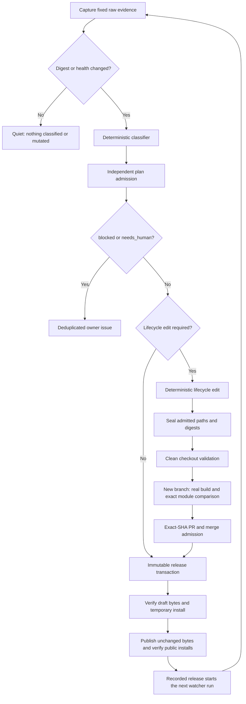
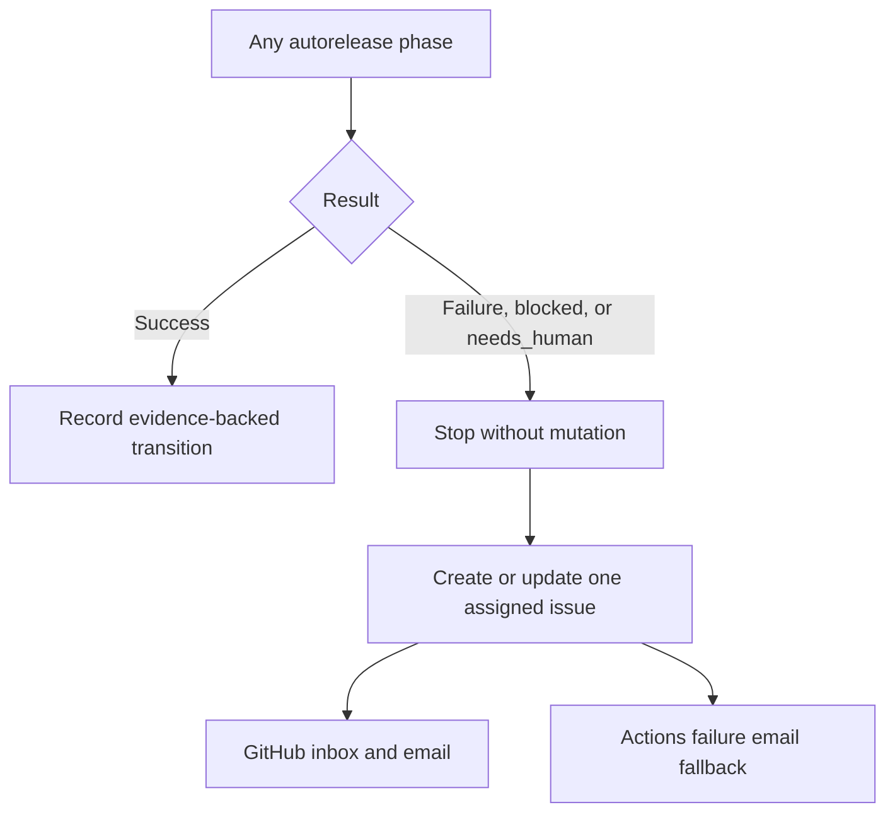

# Autorelease

How this repository detects new upstream PHP releases and lifecycle
changes, prepares bounded repository work, and publishes immutable,
verified macOS 26 arm64 CLI binaries without a human in the loop.

`PHP autorelease watcher` runs every 12 hours, starts again after every recorded
release (see [Chained runs](#chained-runs)), and can also be dispatched
manually. It captures the raw PHP lifecycle page, release feed, php-src tags, and public
state of both repositories, including response metadata and SHA-256 digests.
The aggregate release feed names only the newest release of each major, so the
watcher also captures one feed per branch in `support-policy.json`
(`php_release_feed_<major>.<minor>`), and a new patch on any maintained branch
is admitted from its own branch feed. The branch set follows the accepted
policy, so a new or retired branch changes what is captured with no code
change. Admission also rejects a `new_patch` or `new_branch` whose version the
captured branch feed or aggregate feed already supersedes with a later patch on
the same branch, so an intermediate release never publishes after its
successor. A php-src tag alone never counts as that later release.
Every php.net source is fetched past the CDN edge cache in front of php.net.
That CDN keeps each URL for hours to 30 days per edge and ignores request cache
headers, so the watcher and the publish job could otherwise read different
snapshots of one feed. Each fetch therefore adds a fresh random
`autorelease_fetch` query parameter; the manifest records the canonical URL,
and evidence identity covers only the capture ID, status, and body digest.
A fetch the CDN still reports as a cache `HIT` fails as an unhealthy capture,
so the bypass cannot stop working silently.
Before releasing, the publish job recaptures all evidence, and every capture
the plan cites must recapture unchanged. A stable release is the one exception:
it ignores release feeds that say nothing about its version, meaning other
branches' feeds and, once the plan cites the version's own branch feed, the
aggregate feed. That branch feed is bound even when uncited, so a release on
another branch never stops this one, while any change to this branch's feed,
the repository state, or other cited context still does. The publish job also
reruns the supersession check on the recaptured feeds.
The GitHub releases captures read every page of the list and digest a
projected body with per-asset download counters and draft releases removed, so
public downloads never register as changed evidence, and the read-only watcher
and the publish job's write token digest the same list however the pages
split; the unprojected items are retained beside the digested body as one
canonical JSON array. The
watcher compares
only opaque digests and incomplete-event state. An unchanged healthy day is
quiet: nothing is classified and nothing causes an issue, repository, tag,
asset, or release mutation.

No model takes part in any step. When evidence changes, the deterministic
classifier (`autorelease/_classifier.py`, run by
`scripts/classify-autorelease-evidence`) turns the retained capture into
exactly one plan in `schemas/autorelease-plan.schema.json`, computing every
evidence digest from the bytes it cites. It applies these rules in order and
stops at the first that applies:

1. **Unhealthy evidence.** A capture that did not return HTTP 200, or a failed
   health check, produces a `blocked` plan: nothing can be proven from it.
2. **An incomplete event record** in `autorelease-events/` is resumed under its
   own action key: a `new_branch` release, a `branch_eol` completion, a
   `new_patch`, or the selected `recipe_rebuild`. A record stopped at
   `blocked` or `needs_human`, or one no deterministic path resumes, produces
   `needs_human`. One exception keeps patches moving: when the only incomplete
   record is a `new_branch` or `branch_eol` at `php_bin_ready`, waiting for
   `mise-php` readiness, a patch due under the next rule goes first and the
   record resumes on a later run.
3. **New patches.** For each maintained branch, oldest first, the version that
   branch's own feed names is a `new_patch` when it is not yet published, not
   older than what already shipped on that branch, and not superseded by a
   later patch the aggregate feed names. The plan cites exactly that branch
   feed value. A maintained branch with no shipped release is never a
   `new_patch`: its first release belongs to `new_branch`, which waits for
   both readiness records. When the accepted policy was written by that
   branch's own `new_branch` edit and no record exists, the lifecycle
   resumes (see [Unattended lifecycle](#unattended-lifecycle)), waiting while
   a later patch supersedes the first release; otherwise it produces
   `needs_human`. Admission rejects that patch independently. New
   patches never read the
   supported-versions page, so they go before lifecycle work and keep
   shipping while that page cannot be read.
4. **Lifecycle.** The captured supported-versions page is parsed by a reviewed
   reader that accepts exactly one table shape. A retirement whose policy
   edit already merged without a record resumes first, and no new lifecycle
   edit starts while a new branch's merged edit still waits to resume, since
   that edit would rewrite the policy's action key. A supported branch the policy
   does not maintain is a `new_branch` once the aggregate release feed names
   its first stable release. A maintained branch whose row is marked end of
   life is a `branch_eol` keyed on its security support end date. php.net
   keeps that row for 28 days after the date; a maintained branch with no
   row (for example, one whose window the watcher missed), or an older
   supported branch the policy does not maintain, contradicts the policy and
   produces `needs_human`.
5. **Rebuilds.** The one `rebuildActionKey` the watch decision selected.
6. **No change**, keyed on the manifest's embedded `manifestDigest`.

A body that does not have its reviewed shape (a redesigned lifecycle page, a
feed naming another branch, a releases capture that is not an array) never
leads to a guess: it produces a `blocked` plan, and the watcher raises or
refreshes the deduplicated owner issue for that action key. php.net's
`releases/states.php` is not used.

Admission (`scripts/admit-autorelease-plan`, `autorelease/_admission.py`) then
checks the plan independently. It shares only small pure helpers with the
classifier and re-derives every claim from the capture: the exact field set,
the action key form, evidence digests and locators, release-feed proof and
supersession, that a patch extends a branch that already shipped, the
rebuild selection, allowed paths, and the exact repository and policy
preconditions.

The line between the harness and the product is deliberate. The *harness* is
protected: `scripts/` gates such as `test.sh`, `lib.sh`, `build.sh`,
`package.sh`, and `compare-modules.sh`, the toolchain pins `.spc-version` and
`.spc-sha256`, `tests/`, `autorelease/**`, `schemas/**`, and
`.github/workflows/**`. The *product* is what an admitted lifecycle plan may
write: `support-policy.json` and `expected-modules/`, beside the reviewed
recipe paths `patches/` and `stages/` that change only through a reviewed pull
request. Automation may change what is
built, never what decides whether the build was correct, so the protected
tests are the standing control on every product change. `mise-php` draws the
same line over its own paths; its `AUTORELEASE.md` owns that list.



The release transaction is the only component allowed to create an annotated
tag, draft, assets, or publication. It advances one legal state at a time,
reconciles existing state before acting, never replaces an existing release's
assets with a fresh build, and never overwrites, deletes, or retags a published
release. A first release on a new PHP branch also requires exact-commit
`php_bin_ready` and `mise_ready` records.

The build and the built binary never run beside the write token. StaticPHP
resolves most sources through the GitHub API and runs third-party build
scripts, so the publish workflow builds, gates, and packages the exact commit
in a separate job whose token can only read contents; that token authenticates
StaticPHP's API calls, which anonymous shared runners would lose to rate
limits. The transaction itself runs in three write-scoped jobs, in order, each
only after the one before succeeded:

1. `release` accepts only the build job's artifact, and checks its service
   digest, exact file set, and the archive and `SHA256SUMS` digests the build
   reported before any transition. Reconciling an existing release reuses the
   release's own assets, so it discards the build and still runs when the build
   failed. It advances to a verified draft, downloads the draft (only the write
   token can see one), and hands the draft bytes, the transaction, and the
   event record to the next jobs as one artifact, by ID and digests.
2. `verify-draft`, a job whose token can only read contents and that holds no
   environment, installs the handed-over draft bytes through a temporary local
   release server.
3. `publish` resumes the handed-over transaction. While the release is still a
   draft it recaptures and revalidates the admitted evidence, supersession
   included, because a rerun of the failed jobs reuses the release job's
   handoff without repeating that job's recapture. Evidence that moved stops
   the run with the verified draft left in place, and the next admitted
   dispatch reuses that draft. It then re-reads the draft
   once more, records `publishing`, and only then makes the release public. The
   publication sets GitHub's "Latest" flag explicitly: on only when no published
   release sorts above this version, comparing major, minor, patch, and revision
   as numbers, so a rebuild of an older branch never takes the badge from the
   newest version. A
   run that stops between the publication and its record is therefore still
   known to be possibly live, and reports a warning rather than a failed
   release; so does a rerun that stops early after an earlier attempt already
   published, because the recorded state asks GitHub whether the release is
   public and, only when GitHub cannot answer, keeps an earlier attempt's
   record that it was.
4. `verify-public`, read-only like `verify-draft`, runs fresh public
   exact-version and branch-shorthand installs.
5. `finalize` completes the durable event record through an exact-SHA pull
   request. Rerunning it is safe: a record already on main that completes
   exactly this release, merged by an earlier attempt or recovered by the
   watcher, ends the job without a second record, and a pull request or branch
   an earlier attempt left on the run's own `autorelease/event-<run id>` branch
   is withdrawn before the record is filed afresh. A complete record on main
   that names another release stops the job. `Protected controls` accepts the
   record while the run is still in progress and started on current main or
   an ancestor of it, so a rerun files the record even after main has moved
   on; the watcher's record recovery remains the path once the run has ended.

Both install jobs pass their read-only token to `mise-php`, whose GitHub API
reads would otherwise be rate limited, and restore no mise cache. Every
artifact a job retains is named per run attempt, so rerunning a failed job
never collides with what an earlier attempt kept, and the transaction state
the failure notification and the email digest read is taken from the newest
attempt that retained one. That state records whether the event record is on
main by reading main itself whenever the attempt did not merge it, so a
failed rerun after an earlier merge still reports the record as complete.

Validation deliberately runs the repository's own scripts at the sealed
commit: `autorelease-implement.yml`, and `autorelease-consumer.yml` in
`mise-php`, check out the base SHA, apply the sealed patch, and run
`./scripts/test.sh` from that tree. That is safe precisely because the gates
themselves are protected paths: a patch that touched `autorelease/**`,
`tests/`, or any gate script is rejected at sealing and never reaches
validation, so the code under test can never be the code doing the testing.

A published release whose event record is missing is recovered by the watcher
beside the admitted plan. When that recovery merges, it moves the main the plan
was admitted against, so a plan that would publish, implement an edit, or write
a record against that base waits for the next run instead of failing this one.

Failures use one deduplicated issue per action key, assigned to the username in
`AUTORELEASE_OWNER`. Only a meaningful state, evidence, fingerprint, required
action, or final-result change adds a comment. Critical failures stop mutation.
GitHub Actions failure email is an independent fallback.

`Autorelease email digest` additionally sends one fixed-template TL;DR email
after every completed watcher or publish run attempt, including quiet healthy
days, so silence stops being ambiguous between "no change" and "the schedule
stopped". Both workflows call the digest workflow from their own last job,
with the conclusion their other jobs reached, and nothing else starts it.
GitHub starts no `workflow_run` for a run `GITHUB_TOKEN` started: the watcher
starts every publish run that way, and every recorded release starts the next
watcher run that way (see [Chained runs](#chained-runs)). A `workflow_run`
route would therefore miss those runs and, beside the calls, email the others
twice, so it is not used. A scheduled run, a person's dispatch, and a chained
run each send exactly one digest. The watcher leaves its Pages deployment out
of that conclusion, because a failed deployment never turns the run red.
The template is selected by `email-digest` in `autorelease/control.py` from
retained run state alone and delivered through Resend; no free-form plan prose
reaches the outbound channel, and the workflow skips quietly until the
`RESEND_API_KEY` secret and the email variables exist. Run state that matches
no template — including a corrupt retained artifact — still sends a fallback
summary naming the exact rejection reason, so the channel cannot go silent on
precisely the runs that need a look. Delivery retries transient Resend errors
under one idempotency key per run attempt; a delivery that still fails fails
the digest job, and with it the watcher or publish run, because a red run is
the only report left when the channel is down. Rerunning that run's failed jobs sends
the digest again without repeating any job that passed.
Every watcher digest also carries the fixed-format branch table from that
run's status document (see [Branch status](#branch-status)), followed by one
line naming in-progress work, the selected rebuild, and the captures whose
digest changed, so an "evidence changed" email says what changed. A quiet
day's subject is the document's summary and capture time, such as `All 4
branches current (checked 2026-10-17 09:25 UTC)`. A missing or rejected
document replaces the table with a fixed line saying why, and the template is
still sent. Publish digests carry no table: the only status document a publish
run can reach is the one its watcher captured before the release, so the next
watcher digest reports the published state. The digest job logs the rendered
subject and body.

There is no repair phase. A failed classification input, admission, sealing,
validation, build, or merge stops that run and raises the deduplicated owner
issue; the next watcher run retries from the same deterministic state once the
cause is fixed.



## Chained runs

The classifier admits one action per watcher run, but one upstream release day
brings a patch on every maintained branch, oldest first, and a recipe change
makes every published version rebuild-due. A publish run whose `finalize` job
succeeded therefore ends with `Start the next watcher run`: the release is
live, fresh public installs of it passed, and its event record is complete on
main, merged by that job or found already there. The job holds only
`actions: write`, runs no repository code, and dispatches
`autorelease-watch.yml` on main with `GITHUB_TOKEN`, which GitHub allows to
start `workflow_dispatch` runs. The new run captures fresh evidence and admits
the next due action through the unchanged classification and admission, so a
release day across four branches, or a full rebuild, finishes in hours instead
of days. Dispatching the watcher by hand stays safe but is no longer how a
cascade drains.

- Only that outcome chains. A failed release, a run that stops after
  publication with the release possibly live, and a release whose record did
  not merge start nothing. Selection has no skip, so a rebuild that keeps
  failing is retried by the next scheduled run, and that scheduled run's
  recovery files a pending record.
- A chain ends on its own. The next run checks out the main that holds the
  completed record and captures `php_bin_releases` with the release in it, so
  it cannot select that action again, and admission rejects a completed action
  key regardless. A run with nothing due is quiet or records `no_change`;
  neither dispatches a publish run, so neither starts another watcher run.
  Every link publishes a version or revision that did not exist before, and a
  revision that records the current recipe identity is no longer due, so a
  chain is never longer than the list of due actions.
- Chained runs share the `php-autorelease-watcher` concurrency group with
  scheduled and dispatched runs, and none cancels a run in progress. GitHub
  keeps one pending run per group and cancels the older pending one when
  another arrives. Watcher runs take no inputs and capture everything afresh,
  so the run that remains does exactly what the replaced one would have done.
  A replaced run never started a job, so it captured nothing and sends no
  digest; the run that replaced it reports that work. Only `workflow_run` could
  reach a run that never started, and it would miss a replaced chained run
  while emailing every other run a second time beside the calls.
- A watcher run that starts while a publish run has not yet completed its
  `Record the verified release` job moves nothing on main and dispatches
  nothing: `route-watch-action` returns `deferred_to_publish_in_flight` for
  every plan route that would, and no record recovery for the overlay. Its
  capture predates that record, so it would admit the release in flight a
  second time, and the duplicate would fail its recapture once the first one
  landed. Any change to main would also stop the publish at its own recapture,
  and a recovered record merged ahead of the publish's own record would stop
  its record pull request. The publish starts the run that takes the work once
  it succeeds, and a failed one leaves the work and any missing record to the
  next scheduled run. Only watcher runs dispatch publish runs, and they never
  overlap, so the investigation reads this before it captures and retains the
  answer in `publish-in-flight.json`. Classification, admission, and
  notifications still run as usual, and the digest of such a run says it held
  the admitted action back.
- `autorelease-implement.yml` does not chain. After its edit, a new branch or
  a retirement waits for `mise-php` readiness, which that repository's own
  daily consumer records, so a watcher run started then would only find the
  readiness missing. The first release of a new branch is a publish run, and it
  chains like any other.
- Each chained run on main republishes the [branch status](#branch-status), so
  `status.json` shows a new release within minutes of its record.

## Upstream canary

`Upstream canary` (`.github/workflows/upstream-canary.yml`, twice a day)
builds what php-src has tagged but php-bin has not published, straight from
each tag, with the release recipe and its module gate, in a read-only job. `scripts/select-canary-builds` picks the newest unpublished stable tag of
every maintained branch, built exactly as its release would be, and the newest
tag of any stability for a branch with no module list yet, which covers the
next PHP branch from its first alpha. That one is built the way its
`new_branch` discovery will be (see [Unattended lifecycle](#unattended-lifecycle)),
so it fails only when a release would. Nothing names a PHP version: branches
come from the accepted policy, the module lists, and the tags themselves.

A maintained branch whose module list leaves extensions out is also rebuilt at
its newest stable tag with every extension tried. An extension that compiles
there again is reported in one owner issue titled
`Upstream canary: a left-out PHP extension compiles again`; removing its `!`
line from `expected-modules/<branch>.txt` by pull request changes that
branch's recipe identity, so the watcher rebuilds the branch with it.

php.net announces a patch days after its tag and a branch months after its
first pre-release, so an upstream change that breaks the recipe fails here
first, while there is still time to fix it. A failure files or comments on one
owner issue titled `Upstream canary: a tagged PHP version does not build`, and
the next passing canary, or the first one with nothing left to build, closes
it. Nothing is published, and releases never build from a tag:
`PHP_SOURCE=tag` exists only for the canary.

The recipe itself avoids assumptions about the upstream tree.
`scripts/build.sh` downloads, extracts php-src, and only then builds. Between
those steps it removes every `ext/` directory without a `config*.m4`, since
PHP's build cannot configure it and StaticPHP would otherwise skip extracting
an extension source into it (upstream left `ext/imap/tests` behind after imap
moved to PECL). It also resolves StaticPHP's micro patches itself: for each
one, the newest file not newer than the branch that applies cleanly. StaticPHP's
own table stops at the newest branch it knows and falls back to the oldest
file, which no longer applies to a newer branch.

## Branch status

Each watcher run derives one status document
(`./autorelease/control.py status`, `autorelease/_status.py`, shape in
`schemas/autorelease-status.schema.json`) from what it already captured: each
maintained branch's own release feed, the `php_bin_releases` list, the
supported-versions page, the watch decision, the admitted plan, and the
reviewed snapshot in `autorelease-state/last-evidence.json`. It fetches
nothing and decides nothing, and neither the classifier nor admission reads
it. Per maintained branch it reports php.net's newest release and its date,
php-bin's newest published tag with its revision and publication time, a
status, whether a rebuild is due for the watcher's checked-out recipe, and the
security support end with the days left. A branch is `current` when php-bin
ships the version its feed names, `behind` when it does not, `releasing` when
an admitted plan or an incomplete event record publishes on it, and `unknown`
when a capture it needs was unhealthy or lacked its reviewed shape. Such a
capture is named under `captureHealth`, and the values it would have supplied
stay null rather than guessed. The document also names the run, its trigger,
the admitted action, every in-progress action key, the selected rebuild, and
the captures whose digest differs from the reviewed snapshot. It is validated
against its exact shape when written and again whenever it is read back, so
every rendered value passed the same rules as the email templates.

The watcher publishes the document to GitHub Pages, at
`https://bigpixelrocket.github.io/php-bin/status.json` beside a human-readable
`index.html`, instead of committing it to main:

- Every commit to main changes the `php_bin_state` capture, which wakes the
  classifier and files another evidence record PR.
- Main admits only reviewed pull requests and the automation records
  `Protected controls` admits; a status file is neither.
- The capture time changes on every run, so a committed status would be a
  commit on every run.

The read-only investigation job derives and stages the site. A separate
`Publish branch status` job, holding only `contents: read`, `pages: write`,
and `id-token: write`, deploys it with `actions/deploy-pages`, runs no
repository code, and runs only for `refs/heads/main`, which the `github-pages`
environment enforces again. The derivation can never fail the investigation,
so a status defect cannot hold back a release, and a run without a document
still sends its digest. A failed deployment leaves the previous run's document
in place without failing the run, so the digest still reports the day's real
outcome; the stale `checkedAt` below is what reveals it.

Dashboards should read `status.json` and alert when `checkedAt` is older than
about 24 hours: the watcher runs every 12 hours and GitHub can delay a
schedule by hours, so anything older means the watcher or its deployment stopped. The
README badges read the same document through shields.io dynamic JSON queries
(`$.summary`, `$.badges['<branch>']`, `$.checkedAt`); shields.io cannot filter
a list, which is why each branch's badge message is also keyed by branch, and
like the summary it is recomputed whenever the document is validated.

To reproduce a run's document offline from its retained artifact, give it the
evidence snapshot and the commit that run checked out:

```bash
git show <run-commit>:autorelease-state/last-evidence.json > last-evidence.json
./autorelease/control.py status \
  --run-dir <artifact> \
  --previous last-evidence.json \
  --run-url https://github.com/bigpixelrocket/php-bin/actions/runs/<run-id> \
  --recipe-commit <run-commit> \
  --output status-site
```

## Recipe rebuilds

A published release is immutable, so a recipe change reaches an existing PHP
version only as a new rebuild revision: `8.5.9-1`, then `8.5.9-2`. The
watcher decides which one is due:

- The *recipe identity* of a branch is a SHA-256 over the committed tree
  entries of `.spc-sha256`, `.spc-version`, `LICENSE`, `NOTICE`, `patches/`,
  `scripts/build.sh`, `scripts/install-build-deps.sh`, `scripts/install-spc.sh`,
  `scripts/lib.sh`, `scripts/package.sh`, `stages/`, and that branch's own
  `expected-modules/<branch>.txt` at one exact commit (`recipe_identity` in
  `autorelease/_admission.py`). Adding a branch or changing another branch's
  module list rebuilds nothing. The runner image, unpinned Homebrew packages,
  and the workflow definition are not covered, and changing the covered path
  set itself makes every maintained version due once.
- The publish transaction writes `Recipe identity: sha256:<hex>` into the
  notes of every release it creates, computed at the exact commit it builds.
  The notes come back inside the `php_bin_releases` capture, so the identity
  survives across runs with no extra state.
- A published version on a maintained branch is *rebuild due* when its newest
  revision records a different identity, or none. Every release published
  before identities were recorded is therefore due once.
- `pending_recipe_rebuild` in `autorelease/_state.py` picks one due version
  per run: the newest version of each branch first, then older versions,
  newest first. Its revision is one past the highest published revision.
  `watch-decision.json` reports it as `rebuildActionKey`, and the `rebuild_due`
  trigger runs the classifier even on an otherwise quiet day.
- Admission re-derives the same selection from the same capture, commit, and
  policy. A `recipe_rebuild` plan must name exactly that key, set
  `releaseIntent.version` to `<version>-<n>`, require no edits, allow no paths,
  and cite the `php_bin_releases` tag it supersedes. A `no_change` plan is
  rejected while a rebuild is due, so recorded evidence can never leave one
  pending.
- The admitted rebuild goes straight to the publish transaction. Each
  recorded publication changes `php_bin_releases` and starts the next watcher
  run (see [Chained runs](#chained-runs)), which selects the next rebuild,
  until none is due. Incomplete records, new branches, EOL, and new
  patches take priority in the classifier.
- Selection has no skip: a version whose rebuild keeps failing is selected
  again on every run and holds back the rebuilds ordered after it until the
  recipe is fixed. A failed rebuild starts no next run, so it is retried by
  the next scheduled run rather than in a loop. The `php_bin_releases`
  capture reads every page of the releases list, up to 20 pages of 100, and
  fails as unhealthy rather than truncate a longer list.

## Unattended lifecycle

Adding or retiring a PHP branch takes zero human input. Nothing in the system
is anchored to a particular major or minor: the action keys, version
validators, and policy files all accept any `<major>.<minor>`, so PHP `8.6`,
`9.0`, and `10.0` all travel the same path with no code change.

When upstream evidence first shows a new branch, `autorelease-implement.yml`
first learns the branch's module list from a discovery build at the admitted
base (`DISCOVER_MODULE_LIST` in `scripts/build.sh`, read-only like every
build). Every stage extension is tried. When the build fails and a compiler
error points into an extension's source (`scripts/attribute-build-failure`),
that extension is left out, with every shared extension that requires it, and
the build is retried with the libraries already built. An error inside one of
PHP's own headers belongs to the extension source that included it, a
`configure: error:` belongs to the shared extension whose own configure run
failed (for example one that refuses an unsupported PHP version), and an
error in an extension already left out means StaticPHP built it again as a
dependency, so the tried extensions that depend on it (its own
`spc dev:extensions` table) are left out instead. An error that names no
extension, in PHP itself or a library, fails the run instead of guessing.
StaticPHP stops at the first extension that fails, so a branch most PECL
extensions do not support yet takes one attempt per extension: PHP 8.6.0RC4
needed about two dozen. Discovery therefore runs as up to three passes of
`.github/workflows/autorelease-discover.yml`, each stopping itself before
GitHub's six-hour job limit (`DISCOVER_DEADLINE`) and handing what it left out
to the next (`DISCOVER_RESUME`). When a retry fails with nothing to blame on
libraries built for a larger library set, they are rebuilt once, since a
library such as libcurl can still link against one that is no longer built. The
list is what then built and passed the gate, plus a `!<extension>` line for
each extension left out. New core modules a branch adds are simply part of
what built.

`scripts/apply-autorelease-plan` writes that list as
`expected-modules/<branch>.txt` (the only per-branch recipe input; `stages/`
and `patches/` are shared by every branch) in its canonical form, and
regenerates `support-policy.json` with the branch added, bound to the plan's
evidence digests and action key and accepted at the capture time. The sealed
edit is validated in a clean checkout, and the branch's first release is then
built for real at the validated commit, which must pass the exact module
comparison against the list. Every later build of the branch reads the same
list: a `!` line keeps the extension out, and the comparison stays exact, so a
patch release never silently loses an extension the branch shipped. A list
already on the base, such as one corrected by pull request, is used as it is
and never rediscovered. A run that still fails stops without merging, and the
owner issue for the `new_branch:<branch>` key carries the failure; the next
watcher run with no patch due retries it, and patches on maintained branches
go first and never wait for it.
`mise-php` then regenerates `support-snapshot.json` and `lib/policy.lua`
from the merged policy with its own deterministic scripts. The readiness and
event records then merge on their own: `autorelease-events/`, `autorelease-state/`, and `mise-php`'s
`readiness/` sit outside CODEOWNERS precisely so their exact-SHA automation
PRs satisfy branch protection without a reviewer, while every protected
control still cannot. `Protected controls` admits each record PR only from
`github-actions[bot]` in this repository, as one file directly on the base
commit, from the exact workflow run named by its branch while that run is in
progress on main: evidence from the watcher, which must also have started at
exactly the base commit and carry a matching attestation; completed events
from publish or the watcher; and a lifecycle's `php_bin_ready` record from the
implementation run, which must name the base commit as its validated merge and
carry the policy digests of the base tree. A new branch therefore publishes
with no human approval. Publication waits only on machine facts — matching
`php_bin_ready` and `mise_ready` records at exact commits. The `mise_ready`
record names the mise-php synchronization commit it validated, and the record
itself merges on top of it, so the publish job requires the captured mise-php
`main` to contain that commit and verifies installs with the plugin checked
out at exactly it.

Retirement is the mirror image and equally unattended. A maintained branch
whose supported-versions row is marked end of life becomes
`branch_eol:<branch>:<security support end>`; the lifecycle edit removes it
from `support-policy.json` and leaves its module list in place. That stops
new builds and publication for the branch and delists it from
`mise ls-remote` and branch-shorthand resolution. It removes nothing: every
release already published stays immutable, and an exact version such as
`8.2.32` installs exactly as before, indefinitely.

A lifecycle run can fail after its edit merged but before its `php_bin_ready`
record lands, for example in the build, the merge, or the record PR. A rerun
cannot help, because its admitted base is no longer main. The next watcher run
resumes the action instead: when the accepted policy carries the action's own
key (`new_branch:<branch>` with the branch maintained and its module list
present, or `branch_eol:<branch>:<date>` with the branch removed) and no event
record exists for it, the classifier emits the same lifecycle action with no
allowed paths. Admission re-checks all of that against the checked-out base and
rejects anything else, and a new branch must not have shipped. The
implementation run then finds the edit already present, seals an explicit
empty patch (`alreadyApplied`), validates and, for a new branch, builds main's
exact commit, skips the lifecycle PR and merge, and files the readiness record
for exactly that commit while main is still it. A failed validation or build
reports to the owner issue for the action key, as on the first attempt, and the
next watcher run retries. A readiness PR an earlier attempt left open for the
same key is closed when the next attempt opens its own, so a retry does not
leave the earlier attempt's PR behind.

Unattended mutation is controlled by
`.github/autorelease-operator.json`. Set `unattendedMutation` to `paused` in a
reviewed protected-path PR to stop implementation, merge, and release while
leaving read-only evidence capture and classification available. Re-enable it
through another reviewed PR; an incomplete event then resumes only through its
single legal next transition.

Maintainer commands:

```bash
(cd php-bin && ./scripts/test.sh)
(cd mise-php && ./scripts/test.sh)

./php-bin/scripts/verify-autorelease-system \
  --mise-repo ./mise-php \
  --php-bin-sha <exact-php-bin-sha> \
  --mise-php-sha <exact-mise-php-sha> \
  --output ./verification-results

gh workflow run autorelease-e2e.yml \
  --repo bigpixelrocket/php-bin \
  --ref <reviewed-ref> \
  -f php_bin_sha=<exact-php-bin-sha> \
  -f mise_php_sha=<exact-mise-php-sha> \
  -f suite=production-parity
```

The other suites are `notification-canary`, which creates, replays, and closes
one namespaced issue, and `live-canary`, which installs an already published
version through `mise-php` (`-f live_version=<version>`).

To reproduce a classification offline, run the classifier and admission
against a retained watcher artifact (`gh run download <run-id> --name
autorelease-investigation-<run-id>`):

```bash
./scripts/classify-autorelease-evidence \
  --manifest <artifact>/evidence/evidence-manifest.json \
  --preconditions <artifact>/preconditions.json \
  --events autorelease-events \
  --output plan.json
```

Inspect `autorelease-events/`, generated `support-policy.json`, the reviewed
`autorelease/policy-invariants.json`, retained workflow artifacts, and the
event issue marker to reconstruct a decision. The notifier only trusts issues
and comments written by `github-actions[bot]`: the repository is public, so a
copied marker or fingerprint from anyone else is ignored. `scripts/verify-autorelease-system`
writes `autorelease-verification.json` and `autorelease-verification.md` into
its `--output` directory; both are per-run artifacts, not checked-in files.

`scripts/snapshot-github-admin-state` captures settings,
variables, and secret names without secret values. Recovery never skips
admission or a failed gate: correct the external dependency or submit a
reviewed protected-control change, then rerun the normal workflow.
